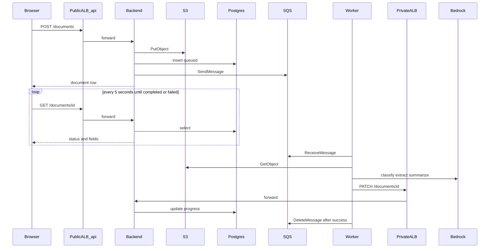

# Solution and AWS architecture

Three independently deployed services. The browser never talks to the AI worker. The worker never opens Postgres.

## One upload

On the public side the browser opens `app.<domain>` for the page and calls `api.<domain>` for `GET` and `POST /documents`. On the private side the worker calls `http://backend.internal`. No task IP appears in any environment variable. See [networking.md](networking.md).

## Who owns which AWS service

| AWS service | Frontend | Backend | AI worker |
| --- | --- | --- | --- |
| S3 uploads bucket | — | PutObject | GetObject |
| SQS documents queue | — | SendMessage | ReceiveMessage, DeleteMessage |
| RDS Postgres | — | read and write | — |
| Bedrock | — | — | Converse / InvokeModel |
| Secrets Manager | — | DATABASE_URL injected at start | — |

CloudWatch logs exist for all three services. ECR holds the three images.

## Why the worker never opens Postgres

Progress goes through the backend's `PATCH /documents/{id}`. That keeps one writer and one security group rule to RDS. The AI task role has no database permission and no `DATABASE_URL`. If the worker needed its own schema later, that would be a new decision. Today the backend owns the row.

## Row status values

The UI polls one row per upload. Status moves through:

| Status | Meaning |
| --- | --- |
| `queued` | Row inserted. SQS message sent. Worker has not started. |
| node name | Graph is at that node, for example `identify_document_node`. |
| `completed` | Graph finished. Unreadable files also end here, with a short report. |
| `retrying` | An attempt failed. SQS redelivers the message in 30 seconds. |
| `failed` | Final. An unsupported file, or the third failed receive. |

`completed` means the graph finished, not that every field was found. Missing fields live in `missing_fields` and in the report.
