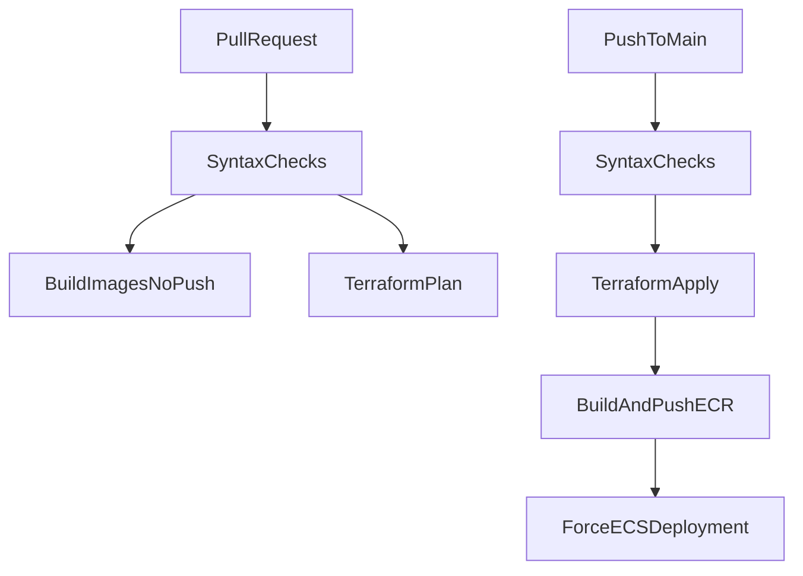

# CI/CD design

Two GitHub Actions workflows. Auth is GitHub OIDC. No long-lived AWS keys in the repository. The deploy workflow is written and not executed for this submission.

## Workflows

| File | Trigger | Jobs |
| --- | --- | --- |
| `.github/workflows/ci.yml` | `pull_request` | syntax checks, unit tests, image builds with no push, then `terraform plan` |
| `.github/workflows/deploy.yml` | `push` to `main` | syntax checks, unit tests, apply, build and push images, force ECS rollout and wait |

Both set `permissions: contents: read` and `id-token: write` for OIDC.

## Syntax checks

Tools the apps already have. No new linter was added for CI.

| App | Check |
| --- | --- |
| Frontend | `npm ci` and `npm run lint` |
| Backend and AI | `python -m compileall backend ai-service` |
| AI service | `python -m pytest -q` |
| Terraform | `terraform fmt -check`, then `init -backend=false` and `validate` |

Pull requests also build the three images and do not push them. `VITE_API_URL` for that build is `http://api.example.test`. `main` still builds and pushes the real images.

## AWS auth and trust

| Role | Trusted for | Can do |
| --- | --- | --- |
| `gha-cda-plan` | `repo:...:pull_request` | Read-only plan, state lock, read the database secret for refresh |
| `gha-cda-deploy` | `repo:...:ref:refs/heads/main` | Apply the main stack, push to ECR, update ECS services |

The workflow split is the readable part. The IAM trust policy is the boundary. A pull request can change the workflow file and still cannot assume the deploy role, because AWS checks the branch claim on the OIDC token.

Roles are created by `terraform/bootstrap`, not by the main stack. A role should not be able to delete its own trust policy in the same apply that uses it. The GitHub roles are named outside the `cda-*` pattern that the deploy role may edit.

## GitHub settings

Filled after bootstrap apply. None are committed.

| Setting | Type | Source |
| --- | --- | --- |
| `AWS_PLAN_ROLE_ARN` | secret | bootstrap output `plan_role_arn` |
| `AWS_DEPLOY_ROLE_ARN` | secret | bootstrap output `deploy_role_arn` |
| `TF_STATE_BUCKET` | variable | bootstrap output `tf_state_bucket` |
| `TF_LOCK_TABLE` | variable | bootstrap output `tf_lock_table` |

The main stack backend is configured at init with `-backend-config` for bucket, DynamoDB table, region, and `encrypt=true`. Local validate keeps using `-backend=false`.

`terraform plan` on pull requests and `terraform apply` on `main` are skipped until `TF_STATE_BUCKET` is set. That variable, the lock table, and the role ARNs come from the bootstrap outputs. Image push and rollout need apply, so they are skipped with it. The syntax checks still run.

## Deploy order on main

1. **`terraform apply`** — creates or updates infrastructure, including ECR repositories.
2. **Build and push** the three images, tagged `:latest` and the commit SHA. Frontend build passes `VITE_API_URL` from the `api_domain` output.
3. **`aws ecs update-service --force-new-deployment`** for all three services so tasks pull the new `:latest`, then **`aws ecs wait services-stable`** so the run fails if the new tasks do not become healthy.

Apply runs first because ECR belongs to Terraform. The first real apply creates services before any image exists, so those tasks fail until step 3. That is one deploy, not a second pipeline.

`concurrency: deploy` on the main workflow so two applies cannot take the state lock at once.

## What this pipeline deliberately does not do

- No `terraform apply` on pull requests. Pull requests do build the three images, without pushing them
- Unit tests cover graph routing, missing fields, and JSON parsing. There are no backend or frontend tests
- No apply or deploy executed for this take-home submission
- No AWS account id or role ARN committed to the repo
