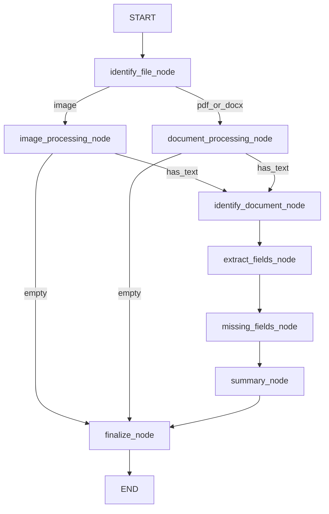

# LangGraph design

The graph lives in `ai-service/agent/`. The worker long-polls SQS, invokes the compiled graph once per message, and deletes the message only after success.

## Nodes and routes



Two conditional routes:

1. **File format** after `identify_file_node`. Images go to Bedrock vision. PDF and DOCX go to local text extraction.
2. **Content** after either processing node. Empty or unreadable text skips classification and goes to `finalize_node`. A completed row still exists for the UI.

Each node PATCHes the private backend with the stage name and any columns it just produced. `finalize_node` sets `completed`.

## State

| Field | Meaning |
| --- | --- |
| `document_id` | Row id from the SQS body. Used for every progress PATCH. |
| `s3_key` | Object key in the uploads bucket. |
| `file_format` | `image`, `pdf`, or `docx`. |
| `content` | Raw text from OCR or local extraction. |
| `status` | Graph-internal: `extracted` or `unreadable`. Not the same as the row status the UI polls. |
| `document_type` | One of the five business labels. |
| `fields` | Structured fields for that type. Missing values are null. |
| `missing_fields` | Field names that are empty after extraction. |
| `report` | One sentence when unreadable. An object after a normal summary. |

## Models

| Step | Env var | Role |
| --- | --- | --- |
| Image text extraction | `BEDROCK_MODEL_ID` | Vision model. Returns readable flag and text. |
| Classification | `BEDROCK_CLASSIFY_MODEL_ID` | Smaller text model. |
| Field extraction | `BEDROCK_CLASSIFY_MODEL_ID` | Same smaller model, typed schema per document type. |
| Summary | `BEDROCK_CLASSIFY_MODEL_ID` | Writes only `summary` and `next_action`. |

PDF and DOCX text is read with `pypdf` and `python-docx` in the worker. A scanned PDF with no text layer is treated as unreadable. It is not sent back through the vision model.

## Classification labels

- Identity Document
- Claim Form
- Policy Document
- Customer Correspondence
- Supporting Evidence

## Validation

`missing_fields_node` does not call the model. It reads the schema for `document_type` from `agent/bedrock/fields.py` and lists every field whose value is null or blank. That list is what the report calls missing information.

## Report shape

After a normal run the report is:

```json
{
  "summary": "...",
  "extracted_information": "...",
  "missing_information": "...",
  "next_action": "..."
}
```

The model writes only `summary` and `next_action`. Extracted and missing fields are copied in code from state, so the model cannot invent a value. An unreadable document gets the string `"The document could not be read."` instead of that object.

## Error handling

| Case | Behaviour |
| --- | --- |
| Unsupported file type | Node raises. Worker catches, PATCHes `failed` and `error_message`, leaves the message. |
| Unreadable or empty text | Routes to `finalize_node`. Status `completed` with a short report. Message deleted. |
| Bedrock, S3, or JSON failure | Same as unsupported type: `failed`, message stays. |
| After 3 receives | SQS moves the message to the dead-letter queue. Visibility timeout is 900 seconds, longer than one graph run. |
