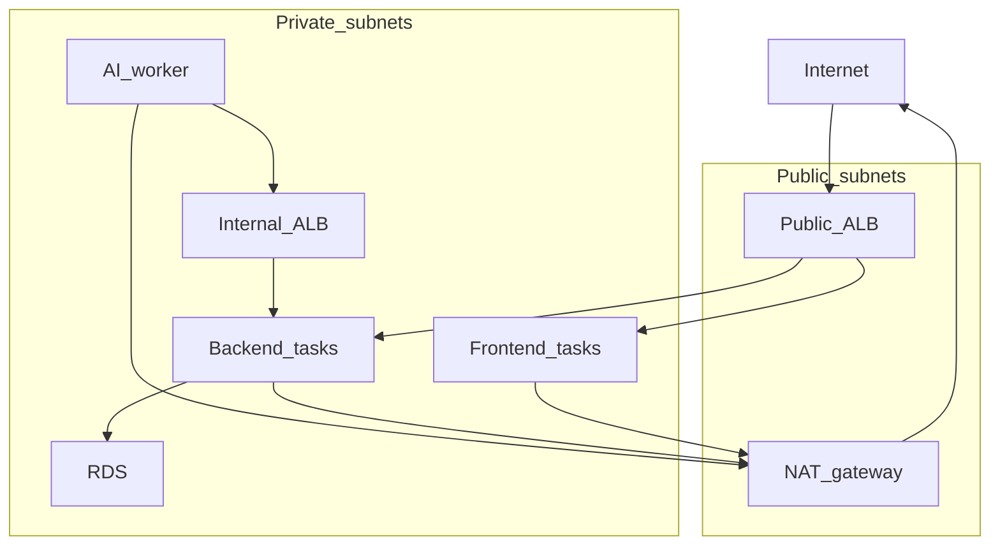

# Networking design

Users reach the frontend and the public API by domain name. The AI worker reaches the backend by a private domain name. Direct IP configuration is not used. The AI service has no public listener and no public IP.

## Topology

VPC `10.0.0.0/16` in two availability zones.

| Subnet | CIDRs | Holds |
| --- | --- | --- |
| Public | `10.0.0.0/24`, `10.0.1.0/24` | Public load balancer, one NAT gateway |
| Private | `10.0.10.0/24`, `10.0.11.0/24` | All three ECS services, internal load balancer, RDS |

All Fargate tasks set `assign_public_ip = false`. Outbound AWS calls (ECR, S3, SQS, Bedrock, Secrets Manager, CloudWatch) go through the NAT.

## Public traffic

One public application load balancer. Two Route 53 records in the public zone:

| Host | Rule | Target |
| --- | --- | --- |
| `app.<domain>` | every path | Frontend target group |
| `api.<domain>` | GET, POST, OPTIONS on `/documents` and `/documents/*` | Backend public target group |
| `api.<domain>` | PATCH | Fixed 403 |
| anything else | default | Fixed 404 |

Two hostnames, not path rules on one host. The React detail page is `/documents/:id`. The API is also `/documents/{id}`. A path rule on one hostname would send a browser refresh of the detail page to FastAPI and return JSON.

`OPTIONS` is allowed so the browser CORS preflight before `POST` reaches the backend. The security boundary for worker updates is the load balancer rule that returns 403 for `PATCH`, not CORS. CORS only lets the page on `app.` call `api.`.

Listeners are HTTP on port 80. The assignment requires domain names, not TLS. Adding 443 later keeps the same host and path rules.

## Private traffic

The worker's `BACKEND_URL` is `http://backend.internal`. That name is a Route 53 private hosted zone alias to an internal application load balancer. The internal listener forwards every request to a second backend target group.

Same uvicorn process, two target groups. A target group belongs to one load balancer, so the public and internal balancers each have their own group, both registered on the one ECS backend service.

## Security groups

| Group | Inbound | Outbound |
| --- | --- | --- |
| Public ALB | 80 from the internet | to tasks |
| Frontend tasks | 80 from public ALB | 443 for ECR and logs |
| Backend tasks | 8000 from public ALB and from internal ALB | 443 for AWS APIs; 5432 to RDS |
| Internal ALB | 80 from the AI worker only | to backend |
| AI worker | none | 443 for AWS APIs; 80 to internal ALB |
| RDS | 5432 from backend only | — |

Nothing on the internet can open a connection to a task. The worker has no ingress rule and no public IP.

## Service discovery choice

The worker discovers the backend through a private DNS name on an internal load balancer.

**Alternative considered:** ECS Service Connect or Cloud Map, so the worker would call a service name without a second load balancer.

**Why the load balancer:** a stable hostname, health checks, and one backend service behind both the public and private doors without a second process. **Cost:** one extra load balancer and its target group.

## Tradeoffs

| Choice | Why | Cost |
| --- | --- | --- |
| One NAT | Private tasks need outbound AWS access without public IPs. Simpler than one VPC endpoint per service. | If that availability zone fails, private tasks in the other zone lose outbound AWS access. A second NAT is the fix. |
| HTTP only | Domain names satisfy the brief. TLS needs a certificate for a domain we control and an apply. | Traffic is not encrypted in transit to the ALB. |
| NAT instead of VPC endpoints | Fewer moving parts for a design that is not applied. | Data path for S3/SQS/ECR leaves the VPC. |
